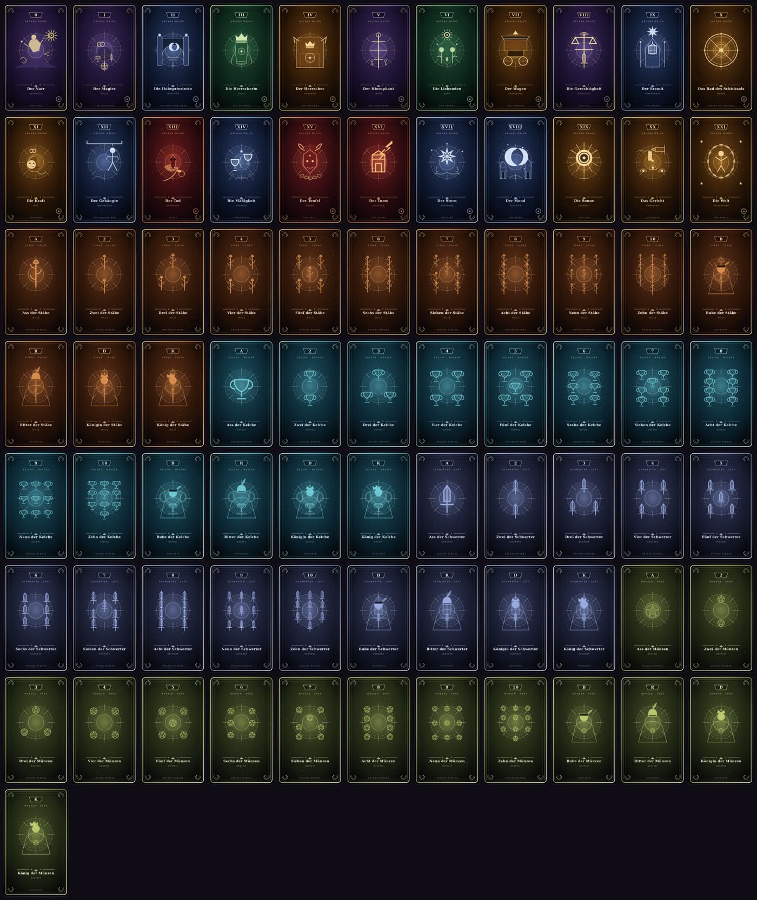

# Arcanum

**Version 0.4.0-beta.1** · Browser-Beta

Ein atmosphärisches Tarot-Stichspiel im Browser: Biete auf deine Stiche, spiele gegen Bots, erkunde alle **78 Karten** im Kodex und trete an einem von zehn Ritualorten an.

## Was diese Version bringt

- **Vollständiges Deck mit eigener Kartenkunst.** Alle 78 Karten (22 Große Arkana, 4 Farben × Ass bis König) werden prozedural als geschichtetes SVG gerendert – 22 individuelle Arkana-Motive, 16 Hofkarten-Figuren, Punktbilder von Ass bis Zehn, gestaltete Rückseite. Keine Bilddateien, keine Emoji, kein CDN für Grafiken.
- **Karten-Kodex, sinnvoll sortiert.** Große Arkana 0–XXI zuerst, danach Stäbe, Kelche, Schwerter und Münzen – jeweils Ass bis König. Suche, sechs Filter, drei Sortierungen und ein Detaildialog mit Symbolik, Rangwert und Regeltext.
- **Großes, gut lesbares HUD.** Karmawert in Großschrift mit Tabellenziffern, Vision/Stiche/Hand als Kennzahlen, Gegnerkarma, Stichbilanzen, Orakel und Phasenband – kontrastreich und auf jeder Breite lesbar.
- **Gerenderte Animationen.** Kartenflug per Bézierkurve mit Geisterkarte, gestaffelte Stichauslage, Treffer-Effekt beim Stichentscheid, zählende Karmawerte, Federphysik und Konfettiregen auf dem Podium. Alles respektiert `prefers-reduced-motion`.
- **Sortierte Hand und lesbare Karten.** Die eigene Hand wird automatisch sinnvoll sortiert (Trümpfe absteigend, danach Stäbe, Kelche, Schwerter, Münzen – je Ass zuerst), Karten sind echte Schaltflächen mit Tooltip und der verdeckte Mond zeigt eine eigene Rückseite.
- **Getrennter Regelkern.** Die komplette Spielmathematik liegt in `js/rules.js` als DOM-freie, testbare Domäne – dieselbe Formel für Partie, Wertungsrechner und Tests.



## Spielidee

Zwei bis sechs Spielende sagen voraus, wie viele Stiche sie gewinnen (**Vision**). Wer anspielt, legt die zu bedienende Farbe fest; Trümpfe sind immer erlaubt. Höchster Trumpf gewinnt, sonst die höchste Karte der angespielten Farbe – das Ass zählt dabei 14,5. Exakte Visionen zahlen Karma, Abweichungen kosten.

Zwei Regelwerke stehen bereit:

| | Turbo | Standard |
| --- | --- | --- |
| Runden | 5 | 7 |
| Karten pro Runde | 5 … 9 | 7 … 13 |
| Orakel | – | 5 Weltgesetze zur Auswahl pro Runde |
| Unterbieten | −10 je Stich | −15 je Stich |
| Hofkarten-Segen | – | +1 bis +4 Karma je gewonnener Hofkarte |

Details, Sonderfälle und die vollständige Punktemathematik stehen in [docs/ARCHITECTURE.md](docs/ARCHITECTURE.md) und [docs/RULES.md](docs/RULES.md).

## Die zehn Orte

1. **Sanctum der Sieben Siegel** – Marmorsanktuarium mit Apsis, Arkaden und Sternrosette.
2. **Hain der Wurzelchronik** – uralter Baum, Wurzelkreis, Moossteine und Samenlicht.
3. **Observatorium am Himmelsgrat** – offene Gipfelsternwarte mit Armillarsphäre und Fernrohr.
4. **Bibliothek der Nachtflügel** – mehrstöckige Galerien, Buchregale, Leitern und Spitzbögen.
5. **Abtei der Tiefenströmung** – versunkene Abtei mit Korallenpfeilern, Glasfenster und Lichtstrahlen.
6. **Sonnenpalast der Glasdünen** – Sandsteinhof mit Hufeisenarkaden, Mosaiken, Palmen und Wasserbecken.
7. **Mondkloster der stillen Gezeiten** – Mondtor, Torii, Kiesgarten und spiegelnder Teich.
8. **Schmiede des Phönix** – Basaltgewölbe, Glutofen, Ambosse, Ketten und Lavaadern.
9. **Kristallhalle des Nordlichts** – Kathedralraum aus Eisprismen, Spitzbögen und Nordlichtern.
10. **Hängende Gärten der Äonen** – schwebende Terrassen, Brücken, Pergola und Wolkenmeer.

## Start

Voraussetzung: ein moderner Browser mit JavaScript. WebGL wird für die 3D-Bühne benötigt; ohne WebGL bleibt das Kartenspiel vollständig bedienbar. Die Kartenkunst wird im Browser erzeugt und braucht keine Verbindung.

```sh
python3 -m http.server 8000
```

Dann `http://localhost:8000/arcanum_tarot_browsergame_codex.html` öffnen. Die HTML-Datei kann auch direkt geöffnet werden. Es gibt keinen Build-Schritt und keinen Paketmanager. Tailwind CSS, Chart.js, Three.js und die Schriften werden zur Laufzeit über CDNs geladen; ohne Chart.js entfällt nur das Diagramm.

## Prüfen

```sh
node --test tests/*.test.cjs
```

Die Tests laufen ohne Browser und prüfen Kartenregister, alle 78 SVG-Motive, Kodex-Sortierung und -Filter, jede Regel und jeden Spezialeffekt, die Wertungsformel (auch gegen die Engine), Determinismus per Seed, die hypergeometrische Wahrscheinlichkeit, die Animationsmathematik sowie die Konsistenz von HTML-IDs, CSS-Breakpoints und Versionsangaben.

Zusätzlich im Browser prüfen: schmales Hochformat, Tablet, Desktop und breiter Monitor; Navigation öffnen, Hand horizontal durchsehen, bieten und Karten spielen, alle zehn Orte wechseln, Modus wechseln, Kodex durchsuchen, Karten-Dialog per Tastatur schließen, Neustart während eines Bot-Zugs.

## Projektstruktur

```text
arcanum_tarot_browsergame_codex.html  Einstieg, semantische Oberfläche, HUD
css/arcanum.css                       Designsystem, Kartenkunst, HUD, Responsive
js/cards.js                           Kartenregister (78 Karten), Effekte, Kodex-Abfragen
js/card-art.js                        Prozeduraler SVG-Renderer für alle Kartenmotive
js/rules.js                           Regelkern: Rangordnung, Züge, Wertung, Stochastik
js/animations.js                      Federphysik, Kartenflug, Karmazähler, Partikel
js/scene3d.js                         Zehn 3D-Architekturen, Materialien, Licht, Avatare
js/engine.js                          Zustandsmaschine, Bot-Züge, HUD- und UI-Updates
js/app.js                             Modus, Regelwerk, Kodex, Diagramm, Rechner, Events
README.md                             Einstieg und Entwicklungsablauf
CHANGELOG.md                          Versionshistorie
docs/ARCHITECTURE.md                  Architektur, Datenmodell und Spielmathematik
docs/RULES.md                         Regelnachschlagewerk mit Sonderfällen
tests/game.test.cjs                   Automatisierte Tests für alle Schichten
LICENSE                               GPL-2.0-Lizenztext
```

## Mitwirken und Versionierung

Änderungen klein halten, die Verantwortlichkeiten der Dateien beibehalten, Tests ausführen und sichtbare Änderungen im Changelog dokumentieren. Regeln ändern sich **nur** in `js/rules.js` – dort liegen alle Wertungskonstanten, und `RULESET_VERSION` wird bei Regeländerungen erhöht. Versionen folgen [Semantic Versioning](https://semver.org/lang/de/): MAJOR für inkompatible Änderungen, MINOR für kompatible Funktionen, PATCH für Fehlerkorrekturen. Die laufende Version steht im `version`-Meta-Tag der HTML-Datei, im Changelog-Kopf und im README; ein Test prüft die Übereinstimmung.

Für einen späteren MMO-Betrieb ist der Regelkern bereits frei von DOM und Rendering und kann als serverautoritäre Domäne dienen; Spielstände besitzen ein versioniertes Schema (`STATE_SCHEMA_VERSION`). Lizenz: siehe [LICENSE](LICENSE).
