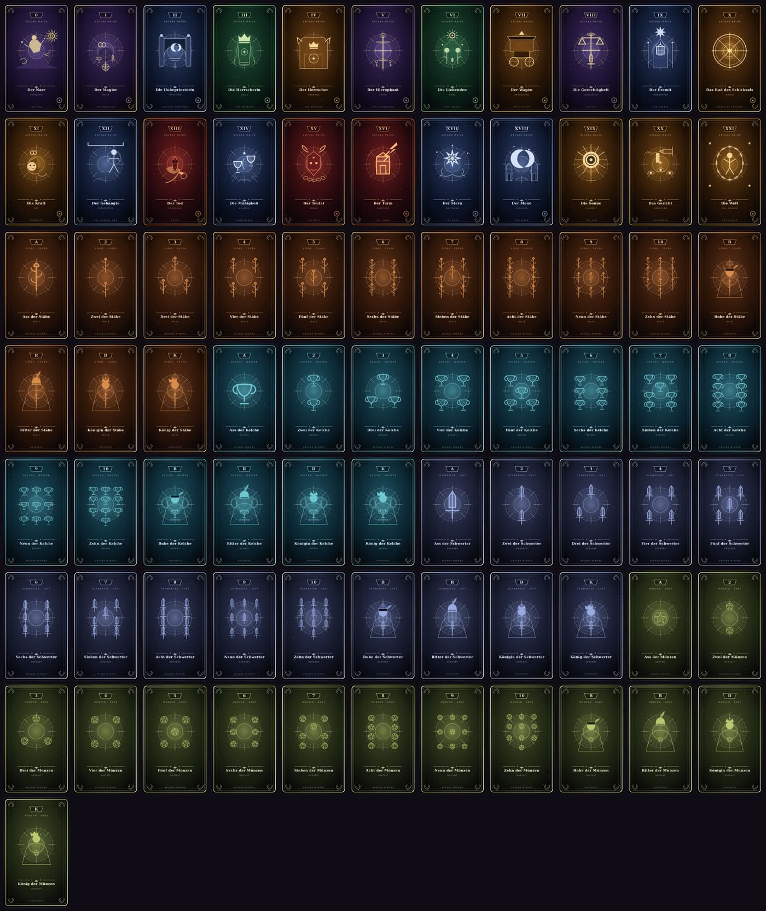

# Architektur, Datenmodell und Spielmathematik

Diese Datei beschreibt, **wie** Arcanum gebaut ist: Schichten, Datenmodell, Regelkern, Darstellung und die Grenzen der aktuellen Beta. Die reine Spielregel-Nachschlage hilft [RULES.md](RULES.md).

## 1 · Schichten und Verantwortlichkeiten

Die Oberfläche ist eine statische Browser-Beta ohne Build-Schritt. HTML und Darstellung sind getrennt; die JavaScript-Module werden als klassische Skripte in fester Reihenfolge geladen und hängen nur über wenige, dokumentierte globale Objekte zusammen.

```
arcanum_tarot_browsergame_codex.html
        │  lädt in dieser Reihenfolge
        ▼
js/cards.js      → ArcanumCards   Daten: 78 Karten, Effekte, Kodex-Abfragen
js/card-art.js   → ArcanumCardArt Kunst: SVG-Renderer für Vorder-/Rückseite
js/rules.js      → ArcanumRules   Regeln: Rangordnung, Züge, Wertung, Stochastik
js/animations.js → ArcanumFx      Effekte: Feder, Kartenflug, Zähler, Partikel
js/scene3d.js    → GameEngine3D   Bühne: Three.js-Orte, Materialien, Avatare
js/engine.js     → GameEngine     Ablauf: Zustandsmaschine, Bot-Züge, HUD
js/app.js        → (IIFE)         UI: Modus, Kodex, Diagramm, Rechner, Events
```

**Abhängigkeitsrichtung (wichtig):** `cards → card-art → rules → animations → scene3d → engine → app`. Die Daten- und Regelschichten (`cards.js`, `card-art.js`, `rules.js`) kennen **kein DOM und kein Three.js**. Nur `engine.js`, `app.js` und `scene3d.js` greifen auf das Dokument zu. Dadurch laufen alle Tests in Node ohne Browser.

| Datei | DOM? | Rendering? | Testbar ohne Browser |
| --- | --- | --- | --- |
| `js/cards.js` | nein | nein | ja |
| `js/card-art.js` | nein | erzeugt SVG-String | ja |
| `js/rules.js` | nein | nein | ja |
| `js/animations.js` | optional | Canvas/Transform | Mathematik ja |
| `js/engine.js` | ja | indirekt | ja (DOM-Stub) |
| `js/app.js` | ja | ja | nein |
| `js/scene3d.js` | ja | WebGL | Manifest ja Layout ja |

### Namenskonventionen

- **Karten** sind eingefrorene Objekte (`Object.freeze`) mit `uid` als einziger Identität. `uid` ist `major-<0…21>` oder `minor-<Farbe>-<1…14>`.
- **Reine Funktionen** liegen in `rules.js`/`card-art.js` und geben neue Werte zurück, statt Zustand zu verändern.
- **Zustand** liegt ausschließlich in `GameEngine` (Partie) bzw. `app` (Oberfläche).
- **Darstellung** schreibt nur in benannte DOM-Knoten; jede ID existiert genau einmal im HTML (per Test geprüft).

## 2 · Datenmodell der Karten

`ArcanumCards.TAROT_DECK` enthält 78 sortierte Karten.

```js
{
  uid: 'minor-Kelche-13',   // eindeutige Kennung
  name: 'Königin der Kelche',
  group: 'cups',            // 'major' | 'wands' | 'cups' | 'swords' | 'pentacles'
  isTrump: false,
  suit: 'Kelche', suitKey: 'cups', element: 'Wasser',
  rank: 13, rankName: 'Königin', index: 'D',
  court: 'queen',           // null | 'page' | 'knight' | 'queen' | 'king'
  value: 13,                // Vergleichswert, Ass = 14,5
  courtKarma: 3,            // Hofkarten-Segen (Standard)
  icon: 'cup', art: 'cup', palette: 'cups',
  keywords: [...], upright: '…',
  effectUid: null,          // Verweis in EFFECTS oder null
  desc: '…'                 // Kurztext für Tooltip/Chronik
}
```

Große Arkana tragen zusätzlich `trumpNum` (0–21), `numeral` (`'0'`, `'I'` … `'XXI'`), `english` und `shortName`. **Der Narr hat den Sonderwert `value: 0`**, damit er auch im reinen Zahlenmodell (z. B. unter dem Rad) als schwächste Karte behandelt wird; die eigentliche Regel „verliert gegen alles“ steht zusätzlich im Rangierer.

### Effektregister

`ArcanumCards.EFFECT_LIST` ist die einzige Quelle der 17 Kodex-Effekte (3 Turbo-Schlüsselkarten, 9 Schicksalskarten, 5 Orakel). Jeder Eintrag hat `uid`, `type` (`turbo|schicksal|orakel`), `mode` (`both|standard`), `title`, `text` (Regeltext) und `short` (Kurzfassung für Karten und HUD). `ORACLE_UIDS` leitet die fünf Orakel für die Rundenauswahl ab.

Die verdeckte Karte des Mondes (`ArcanumCards.CONCEALED_CARD`) ist **keine** Deckkarte, sondern ein vollständiger Darstellungsplatzhalter mit eigener `uid` (`concealed-moon`), Palette und dem Flag `concealed`. Dadurch laufen Kartenkunst und Markup ohne Sonderpfad; `ArcanumCardArt.face` zeichnet für sie die Rückseite.

`sortHand(cards)` sortiert die Spielerhand anzeigefreundlich: Trümpfe absteigend (XXI … 0), danach die Farben in Kodex-Reihenfolge, innerhalb einer Farbe absteigend nach Rangwert.

Hofkarten haben **keinen** `effectUid`: Ihr Effekt (Hofkarten-Segen) ist ein einfacher Karmawert je Rang und liegt als `courtKarma` direkt an der Karte.

### Kodex-Abfragen

`filterCodexCards({ search, filter, sort })` bedient die Oberfläche:

- **Sortierung:** `canonical` (Große Arkana 0–XXI, danach Stäbe/Kelche/Schwerter/Münzen je Ass → König), `alpha`, `effect` (Effektkarten zuerst).
- **Filter:** `all`, `majors`, `courts`, `effects`, `oracles`, `schicksal`, `standard`, `turbo`, `wands`, `cups`, `swords`, `pentacles`.
- **Suche:** Name, englischer Name, Symbolik, Farbe und Kartentext.

## 3 · Kartenkunst

`ArcanumCardArt.face(card)` erzeugt pro Karte ein eigenständiges SVG (viewBox `0 0 240 400`) in fünf Schichten:

1. **Grundfläche** – Palettengradient, deterministischer Sternenstaub (FNV-1a-Seed aus der `uid`), Vignette.
2. **Rahmen** – doppelte Goldlinie, vier Eckfleurons, Nummernkartusche, Kopf- und Fußzeile.
3. **Bildfeld** – Strahlenkranz, Halo, Sigillring.
4. **Motiv** – 22 handgezeichnete Arkana-Szenen, 4 Hofkarten-Figuren mit Farbemblem oder Punktbild (Ass groß, 2–10 im Raster).
5. **Schrift** – Kartentitel, Schlüsselwort, Effektmarke.



*Alle 78 Kartenmotive, gerendert aus `ArcanumCardArt.face()` (Zeilen: Große Arkana 0–XXI, Stäbe, Kelche, Schwerter, Münzen).*

Farben stammen aus neun Paletten (`aether`, `lunar`, `solar`, `infernal`, `verdant`, `wands`, `cups`, `swords`, `pentacles`). Weil alle Motive aus denselben Bausteinen (`SYMBOLS`, `haloLayer`, `frameLayer`) entstehen, bleibt die Kunst konsistent und ist gleichzeitig vollständig datengetrieben – ein Test prüft, dass alle 78 Vorlagen einmalig und frei von `NaN`/Emoji sind.

## 4 · Regelkern (`js/rules.js`)

Alle Spielregeln sind reine Funktionen. `RULESET_VERSION` wird bei jeder Regeländerung erhöht.

| Funktion | Aufgabe |
| --- | --- |
| `CONFIG` | Alle Regelparameter (Spielerzahl, Modi, Wertung, Rangschalter) an einer Stelle |
| `cardsPerPlayer(mode, round)` | Rundengröße (Turbo 4+n, Standard 6+n) |
| `createRng(seed)` | deterministischer Zufall (mulberry32) für reproduzierbare Partien |
| `shuffle`, `createDeck`, `deal` | Mischen, Deck, Verteilung ohne Mutation |
| `pickOracle(rng)` | Orakel der Runde (nur Standard) |
| `createRanker({ leadSuit, oracleUid, cancelled, maxMinor })` | Rangfunktion eines Stichs |
| `legalCardIndices(hand, ctx)` | Bedienpflicht, Kraftverbot, Teufelszwang |
| `describeConstraint` | Klartext-Hinweis für die Oberfläche |
| `resolveTrick(trick, ctx)` | Stichauswertung inklusive aller Effekte |
| `courtKarmaOf` | Hofkarten-Segen |
| `scoreRound({ mode, bid, won, oracleUid, courtKarma })` | Rundenwertung |
| `chanceOfAtLeastOneTrump`, `expectedTrumps` | hypergeometrische Stochastik |
| `validateDeck` | Datenintegrität (Deckgröße, Eindeutigkeit, Effektverweise) |

### Rangordnung in einer Zeile

`createRanker` liefert einen Zahlenwert; die höchste Zahl gewinnt:

| Situation | Rangwert |
| --- | --- |
| Narr (0), nicht annulliert | `−1000` (verliert immer) |
| Kraft (XI), nicht annulliert | `5000` (gewinnt alles) |
| Magier (I) | `maxMinor + 0,5` (unter dem Rad: `100 + 15 − maxMinor + 0,5`) |
| Rad des Schicksals aktiv | Kleine Arkana `100 + (15 − value)`, Große `22 − trumpNum` |
| Übrige Große Arkana | `200 + trumpNum` |
| Herrscherin aktiv, Kelche | `100 + value` (niedere Trümpfe) |
| Kleine Arkana der angespielten Farbe | `value` (Ass 14,5) |
| Kleine Arkana anderer Farbe | `−500 + value` (wertlos) |

Sonderfälle in `resolveTrick`: Der Narr entthront die Welt, wenn er **unmittelbar** nach ihr fällt (und keine Kraft im Stich liegt). Der Turm vernichtet den Stich (`won = 0`), der Tod halbiert ihn (`won = 0,5`), der Turm hat Vorrang. Der Hierophant setzt `cancelled = true` und schaltet alle Karteneffekte ab – Orakel bleiben aktiv.

### Wertungsmathematik

Alle Konstanten liegen in `CONFIG.scoring` und werden von Partie, Rechner und Tests gemeinsam genutzt:

| Fall | Punkte |
| --- | --- |
| Vision exakt, > 0 | `+20 + 10 · Stiche` |
| Vision 0, keine Stiche | `+50` |
| Vision 0, Stiche gewonnen | `−50` |
| Abweichung, Überbieten | `−10 · gerundete Abweichung` |
| Abweichung, Unterbieten im Standard | `−15 · gerundete Abweichung` |
| Abweichung im Turbo | immer `−10` je Schritt |
| Orakel Stern, exakte Nicht-Null-Vision | `+30` zusätzlich |
| Hofkarten-Segen (Standard) | `+courtKarma` je gewonnener Hofkarte (Bube 1 … König 4) |

**Halbe Stiche.** Der Tod kann einem Stich 0,5 Stiche geben. Ein Treffer liegt nur bei exakter Gleichheit vor. Abweichungen werden auf ganze Stiche **gerundet** (0,5 → 1, 1,5 → 2), damit alle Karmawerte ganzzahlig bleiben. Beispiele: Vision 1 / 1,5 Stiche → −10 (Überbieten); Vision 1 / 0,5 → −15 (Unterbieten, Standard).

### Stochastik

`chanceOfAtLeastOneTrump(n, deck, trumps) = 1 − Π (deck−trumps−i)/(deck−i)` für `i < n` – exakt hypergeometrisch, auf Hundertstelprozent gerundet. Bei 78 Karten und 22 Trümpfen: 1 Karte 28,21 %, 5 Karten 81,91 %, ab 57 Karten 100 %. Das Diagramm zeigt zusätzlich `P(≥ 2 Trümpfe)` über `1 − P(X ≤ 1)` und passt die Werte an die Rundengrößen des aktiven Modus an.

## 5 · Spielablauf (`js/engine.js`)

Zustandsmaschine: `bidding → playing → roundOver → (bidding | gameOver)`.

- `initGame(n)` setzt Spielende, Rundenzähler, leert Timer und Chronik.
- `startRound()` mischt, teilt, zieht das Orakel und öffnet das Bieten.
- `submitHumanBid(b)` übernimmt die Vision, lässt Bots schätzen (`estimateBotBid`) und startet die Stiche.
- `playCard(playerIdx, cardIdx)` prüft Phase, Reihenfolge und Zulässigkeit, hebt den Teufelszwang auf, legt die Karte in den Stich und startet ggf. die Auswertung.
- `evaluateTrick()` ruft `ArcanumRules.resolveTrick` auf, verkündet das Ergebnis, wendet Effekte an und setzt die Eröffnung.
- `evaluateRoundScores()` wertet über `ArcanumRules.scoreRound`, aktualisiert `roundSummary` und startet die nächste Runde oder das Podium.

Alle Timer laufen über `schedule()` und werden bei Neustart oder Moduswechsel über `clearTimers()` verworfen. Effekte wirken ausschließlich hier – die UI entscheidet nie über Gültigkeit oder Wertung.

**Bot-Heuristik:** `Trümpfe + gerundet(Hofkarten · 0,34) + gerundet(hohe Farbkarten · 0,25)`, begrenzt auf die Rundengröße. Bots spielen die höchste zulässige **Nicht-Trumpf-Karte**, wenn möglich, sonst den höchsten zulässigen Trumpf.

## 6 · HUD und Darstellung

Das HUD besteht aus vier Blöcken und liest ausschließlich Zustand, den die Engine ohnehin hält:

1. **Kachelband** – Runde mit Fortschrittsbalken, Weltgesetz (Orakel), Regelwerk.
2. **Phasenband** – aktueller Zugstatus mit Farbcodierung je Phase.
3. **Karmakarte** – Karmawert in `clamp(52px, 6,4vw, 86px)` mit Tabellenziffern, Kennzahlen Vision/Stiche/Hand, Zielhinweis.
4. **Seitenleiste** – Gegnerkarma und Stichbilanz mit Fortschrittsbalken.

`renderHud()` schreibt in feste IDs, `renderUI()` erzeugt Hand- und Stichkarten über `cardMarkup()`. Kartenmarkup und SVG-Kunst sind getrennt: `ArcanumCardArt` liefert das Motiv, das Markup nur Rahmen, Besitzerlabel und Tooltip.

## 7 · Animationsschicht

`ArcanumFx` ist eine kleine, DOM-freundliche Werkzeugkiste ohne Bibliothek:

| Baustein | Wirkung |
| --- | --- |
| `springStep` | gedämpfte Feder (Halbschrittintegration, stabil auch bei < 30 fps) |
| `flightPoint` | quadratische Bézierkurve für den Kartenflug |
| `fanTransform` | Fächerwinkel und Hub je Handkarte |
| `cardFlight` | Geisterkarte fliegt vom Handfach zum Stich |
| `clash` | Shake plus Trefferlabel beim Stichentscheid |
| `scoreCounter` | zählender Karmawert mit Auf-/Ab-Farbcodierung |
| `confetti` | Partikelregen für das Podium |

Alle Animationen prüfen `prefers-reduced-motion` und springen dann sofort ans Ziel. Bewegungen laufen über `transform`/`opacity`, damit sie auf dem Compositor bleiben.

## 8 · Spielstand und Persistenz

`GameEngine.serialize()` liefert ein versioniertes, DOM-freies Objekt:

```js
{ schema: STATE_SCHEMA_VERSION, ruleset: RULESET_VERSION, mode, numPlayers,
  round, maxRounds, phase, activePlayerIdx, leadSuit, oracle,
  trick: [{ playerIdx, uid, hidden }] }
```

Es gibt weiterhin **kein** `localStorage` und keine serverseitige Speicherung: Ein Neuladen verwirft die Partie. Das Schema ist die Grundlage für spätere Persistenz und Netzwerksnapshots; `schema` muss dafür bei Formatänderungen erhöht und migriert werden.

## 9 · Zehn individuelle 3D-Orte

`GameEngine3D.environments` bleibt die alleinige Datenquelle für Kennungen, Namen, Kurzbeschreibungen, Materialfamilien, Beleuchtungsfarben und je einen unterschiedlichen Architekturbauer. `buildEnvironment()` verwirft die Ressourcen des alten Szenen-Wurzelknotens, setzt Atmosphäre und Grundfläche neu auf und ruft genau einen dieser eigenständigen Räume auf:

| Kennung | Architekturbauer | Kompositorischer Schwerpunkt |
| --- | --- | --- |
| `temple` | `buildSanctum()` | Marmor-Apsis, Säulenarkaden, Treppen und Sternrosette |
| `druid` | `buildGrove()` | Baumchronik, verästelte Stämme, Wurzelkreis und Runensteine |
| `mountain` | `buildPeak()` | offene Gipfelkulisse, Armillarsphäre, Fernrohr und Cairns |
| `library` | `buildLibrary()` | Bücherwände, Galerien, Leitern, Spitzbögen und farbige Buchrücken |
| `undersea` | `buildUndersea()` | Korallenpfeiler, Glasfenster, Kelp und Meereslichtstrahlen |
| `desert` | `buildDesert()` | Hufeisenarkaden, Gitter, Sonnenrosette, Palmen und Wasserbecken |
| `moon` | `buildMoon()` | Mondtor, Torii, Kiesgarten, Laternen und Spiegelfläche |
| `forge` | `buildForge()` | Glutofen, Basaltrippen, Ketten, Ambosse und Lavaadern |
| `ice` | `buildIce()` | Eisnave, prismatische Stützen, Spitzbögen und Nordlichtbänder |
| `sky` | `buildSky()` | schwebendes Felsbett, Seiteninseln, Hängebrücken, Pergola und Wolken |

Die Räume teilen nur Bühne, Ritualtisch, Sitzkreis und Avatar-Grundmodell – nicht ihre architektonische Silhouette. `clearEnvironment()` entsorgt Geometrien, Materialien und Texturen beim Ortswechsel. Die Renderer-Pixeldichte ist auf 1,75 begrenzt (1,25 auf leistungsschwachen Geräten); die Kamera rechnet bei jeder Größenänderung ihr Seitenverhältnis neu (`cameraDistanceForAspect`), damit Tisch und Sitzkreis auch im Hochformat im Bild bleiben.

## 10 · Responsives Verhalten und Barrierefreiheit

Fluide Abstände, Typografie und Bühnenhöhe (`clamp()`), ein Klappmenü ab 900 px und umfließende Steuerleisten. Breakpoints: 1180 px (HUD zweispaltig), 900 px (Mobile-Navigation), 700 px (kompaktes HUD, einspaltige Steuerung), 430 px (HUD einspaltig), plus Querformat-Sonderfälle. Alle interaktiven Ziele sind mindestens 44 px groß, Zahlen verwenden Tabellenziffern, Fokus ist sichtbar (`:focus-visible` mit doppeltem Ring), Dialoge fangen den Fokus ein und schließen mit `Escape`, Statusänderungen laufen über `aria-live`-Regionen, und `prefers-reduced-motion` schaltet alle Animationen ab.

## 11 · Grenzen der Beta und Weg zum MMO

Die aktuelle Version ist **kein MMO-Client**: Spielregeln laufen im Browser, Bot-Timer und UI sind klientenseitig, es gibt keine Accounts, Transportebene, Serverautorität oder Persistenz.

Der Regelkern ist dafür bereits vorbereitet: `js/rules.js` ist frei von DOM und Rendering, alle Zufallsquellen akzeptieren einen Seed, und Spielstände sind versioniert. Für Netzwerkbetrieb sollte eine serverautoritäre Zustandsmaschine validierte, versionierte Spielerbefehle annehmen und unveränderliche Ereignisse (`CardPlayed`, `TrickResolved`, `RoundScored`) publizieren; Clients rendern diese Ereignisse und entscheiden nichts. Dazu gehören serverseitige Seeds, Reconnect-Snapshots, Schema-Migrationen, Missbrauchsschutz und Tests mit reproduzierbaren Partien. Keine dieser Netzwerkfunktionen ist in der Beta implementiert.

Neue UI- und Renderfunktionen sollen die Regeln nicht duplizieren: Regeln ändern sich ausschließlich in `js/rules.js`, Karten ausschließlich in `js/cards.js`.

## 12 · Wartbarkeit und Tests

`node --test tests/*.test.cjs` prüft unter anderem:

- 78 eindeutige Karten, 22 Große Arkana, 16 Hofkarten, Ass = 14,5, Effektregister vollständig.
- Alle 78 SVG-Motive einmalig, gültig und frei von Emoji/`NaN`; 22 unterschiedliche Arkana-Motive; Punktbilder zählen korrekt.
- Kodex-Reihenfolge (Große Arkana vor Farben) und alle Filter.
- Jede Regel und jeden Sonderfall: Narr/Welt, Magier, Kraft, Turm, Tod, Hierophant, Gerechtigkeit, Mond, Herrscherin, Rad, Liebende, Hofkarten-Segen.
- Wertung inklusive halber Stiche, Stern und Hofkarten – zusätzlich gegen den Engine-Pfad.
- Determinismus (gleicher Seed, gleiche Partie) und eine komplette Runde, die regelkonform terminiert.
- Hypergeometrische Wahrscheinlichkeit und Monotonie.
- Animationsmathematik (Federkonvergenz, Bézier-Endpunkte, Fächersymmetrie).
- Konsistenz von HTML-IDs, Skriptreihenfolge, CSS-Breakpoints und Versionsangaben.
