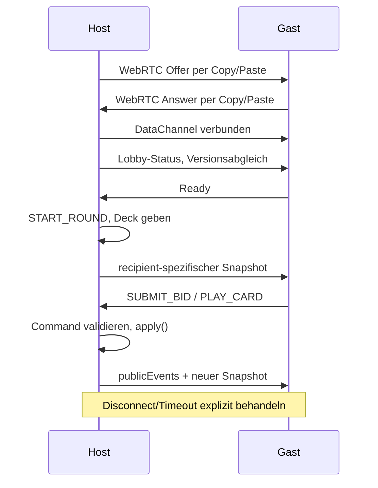

# ADR 0001 — Hybrid-Multiplayer und DOM-freier Spielkern

- **Status:** Angenommen; DOM-freier Core und Browser-Adapter implementiert, WebRTC noch nicht
- **Datum:** 2026-11-24
- **Bezug:** ARCANUM 0.6.0-beta.2, `main` bei `aa5045b06b6d39071fbf252d02b24016f27cf560`

## Kontext

ARCANUM ist eine statische Browseranwendung mit klassischen globalen Skripten ohne zwingenden Build-Prozess. `js/cards.js` definiert das 78er-Deck, `js/rules.js` enthält DOM-freie Regeln und `js/engine.js` verbindet Spielablauf mit Bots, Timern und DOM. Die bisherige `GameEngine.serialize()`-Ausgabe enthält nicht sämtliche Hände und Regelmodifikatoren; sie ist **kein** vollständiger Reconnect-Snapshot. Es existiert kein Netzwerktransport.

Entscheidungen des Projekts: **Hybrid-Multiplayer**, **PWA**, später **kosmetische Monetarisierung**, zuerst **private Multiplayer-Partien**, am Anfang **keine verpflichtenden Serverkosten**. Keine Big-Bang-Portierung auf ein anderes UI-Framework.

## Entscheidung

1. Der DOM-freie Core wird als getrennte Domäne aufgebaut: `game-state.js`, `game-commands.js`, `game-reducer.js`. Er verwendet `ArcanumRules` und das Kartenregister durch Dependency Injection. Kein DOM, kein Three.js, keine Timer und keine Netzwerk-I/O im Reducer.
2. Alle Spielzüge sind versionierte Commands. Der Host ordnet sie in einer monotonen globalen Sequenz. Der Reducer verarbeitet sie deterministisch und erzeugt einen neuen Zustand plus Events. Ungültige Commands verändern den alten Zustand nicht.
3. Private Spiele verwenden zunächst WebRTC DataChannel und manuelles Signaling (Offer/Answer per Copy/Paste), um die Verfügbarkeit **ohne eigenen laufenden Backend-Server** zu erproben. Ein Host koordiniert Spielzustand und Kartenausgabe.
4. Die Clients erhalten **recipient-spezifische** Snapshots. Eigene Karten dürfen im privaten Snapshot erscheinen; Hände anderer Spieler nicht. Ein verdeckter Mond darf auch nicht durch die öffentliche Eventprojektion verraten werden. Es ist untersagt, interne vollständige `state`-Objekte zu broadcasten.
5. Die PWA bleibt ein statischer Client (voraussichtlich GitHub Pages). Offline-Spiel gegen Bots wird erhalten. Installierbarkeit/Service-Worker sind ein späteres, separates Arbeitspaket.
6. Für Ranked, Turniere oder handelbare/kaufbare Belohnungen wird eine **serverautoritative** Spielinstanz vorausgesetzt. P2P-Host ist nicht vertrauenswürdig; lokale Validierung ersetzt keine Host-Autorität.
7. Der bestehende Renderer und `js/app.js` bleiben erhalten. `js/core/legacy-adapter.js` wird in der HTML-Ladereihenfolge zwischen `engine.js` und `app.js` eingefügt und ersetzt die zustandsverändernden Methoden durch Commands an den Core. Es gibt derzeit keinen Runtime-Feature-Flag; die Legacy-Engine dient als Regressionstest-Referenz. Die Rückfallstrategie erfolgt über Git-/Release-Rollback.

## Game-Core-API v1

### Laden (Node oder klassischer Browser)

Die drei Module sind CommonJS-kompatibel und erzeugen zusätzlich die globalen Objekte `ArcanumGameState`, `ArcanumGameCommands`, `ArcanumGameReducer`. Browser-Ladereihenfolge: `game-state.js`, `game-commands.js`, `game-reducer.js`, **nach** `cards.js` und `rules.js` und **vor** einem späteren Multiplayer-Adapter.

### `createGame({ rules, cards, mode, playerIds, seed }) → state`

- 2–6 eindeutige Spieler-IDs.
- Modus `turbo`, `standard`, `raw`, gemäß `rules.MODES`.
- Expliziter 32-Bit-Seed; kein `Math.random()` im Core.
- Versionen `schema` und `ruleset` im Zustand; internes RNG-State wird mitgeführt.
- Anfangszustand ist leer (`bidding`); durch `START_ROUND` werden Hände und Orakel erstellt.

### `apply(state, command, { rules, cards }) → { state, events }`

- Reine Funktion, keine Mutation des Eingabestands.
- Global monoton `sequence === state.sequence + 1`.
- Commands: `START_ROUND`, `SUBMIT_BID`, `PLAY_CARD`, `CHOOSE_PRIESTESS`, `NEXT_ROUND`.
- Karten werden per `cardUid` adressiert, nicht per UI-Handindex.
- Regeln werden weiterhin ausschließlich durch `ArcanumRules` definiert.
- `CHOOSE_PRIESTESS` ist explizit, damit der Reducer keinen synchronen Browser-`confirm()`-Dialog ausführt. In der Multiplayer-Oberfläche muss der Gewinner diese Wahl beantworten.
- Events sind **intern**; vor der Weitergabe `publicEvents(events)` aufrufen und private Information nach Empfänger projizieren.

Beispiel:

```js
const state = ArcanumGameState.createGame({ rules: ArcanumRules, cards: ArcanumCards,
  mode: 'raw', playerIds: ['p1', 'p2'], seed: 12345 });
const result = ArcanumGameReducer.apply(state,
  { type: 'START_ROUND', sequence: 1 }, { rules: ArcanumRules, cards: ArcanumCards });
const publicStateForP1 = ArcanumGameState.snapshotFor(result.state, 'p1');
```

### `snapshotFor(state, recipientId) → public/private view`

- Keine fremden Handkarten und keine geheime Deck-/RNG-Information.
- Karten des verdeckten Mondes werden nur ohne UID gezeigt.
- **Wichtig:** Snapshots ersetzen keine authentifizierte Spielerzuordnung. Der Host darf `recipientId` nicht ungeprüft aus einer vom Client frei wählbaren Eingabe übernehmen.

## Sequenz der privaten Partie



## Fehler- und Sicherheitsmodell

- **Replay/Duplikate:** Falsche Sequenzen werden verworfen. Vor Produktionsbetrieb zusätzlich `matchId`, `commandId`, Actor-Authentifizierung, Idempotenz und Begrenzung der Nachrichtengröße im Transport implementieren.
- **Regelkompatibilität:** `ruleset` muss übereinstimmen, andernfalls Verbindung ablehnen.
- **Disconnected Host:** Im MVP Partie anhalten oder abbrechen; Host-Migration ist nicht zugesichert.
- **Reconnect:** Noch nicht implementiert. Kein persistenter Event-Store; im MVP ist eine neue Partie bei unwiederherstellbarem Abbruch zulässig. Später signierte/validierte Zustandsfolge plus Wiederaufnahme.
- **Host-Betrug:** Host kennt alle Hände und den Seed. Der P2P-Modus ist explizit **unranked**. Keine Echtgeld-Einsätze und keine wettbewerbsrelevanten Kaufvorteile.
- **STUN/TURN:** NAT-Traversal kann fehlschlagen. TURN-Relay verursacht potenziell Betriebskosten. Kostenloser Start garantiert keine Verbindung zwischen beliebigen Netzen.
- **WebRTC Mesh:** Für 6 Teilnehmer muss Bandbreite und Stabilität auf Mobilgeräten getestet werden; alternativ Host-Sternmodell.
- **Versionierung:** Daten- und Protokollschema erhalten eigenständige Versionen; ungültige Versionen werden zurückgewiesen.

## Alternativen und Folgen

- **Vollständig zentraler Echtzeit-Server ab Tag 1** abgelehnt wegen Infrastruktur- und Betriebskosten.
- **Reines P2P auch für Ranked** abgelehnt wegen Betrugs- und Integritätsrisiko.
- **React/TypeScript/Monorepo vor Multiplayer** vorerst abgelehnt wegen unnötigem Migrationsrisiko.

Folgen: für private Partien zunächst schlechtere Verbindungs-UX, technische Host-Abhängigkeit und keine manipulationssicheren Ergebnisse. Im Gegenzug können Domainlogik und Netzwerktransport getrennt entwickelt werden.

## Lizenz- und Asset-Gate vor Monetarisierung

Die Datei `LICENSE` enthält GPL-2.0-Text, `package.json` gibt dagegen `ISC` an. Das ist **keine geklärte Lizenzlage**. Vor Shop, proprietären Erweiterungen und kommerziellen Distributionsentscheidungen:

1. Urheber und Rechteinhaber sämtlicher Dateien und Medien dokumentieren; Zustimmung aller Mitwirkenden zur beabsichtigten Lizenz einholen.
2. GPL-2.0-Kennzeichnung (only/or-later) anhand tatsächlicher Copyright-Hinweise klären; nicht bloß die Datei austauschen.
3. Drittanbieter-Bibliotheken `vendor/three`, `vendor/chart` sowie Tailwind, Fonts, Sounds, Bilder und Assets inventarisieren und jeweilige Lizenz-/Attribution-Pflichten erfassen.
4. Store- und PWA-Distribution, Source-Code-Pflichten, Datenschutz und mögliche Markenrechte überprüfen.
5. Ergebnis als getrennte `docs/LICENSING-AUDIT.md` mit Verantwortlichem und Nachweisen festhalten.

**Kommerzielle Nutzung ist unter GPL nicht pauschal verboten.** Ein Lizenzwechsel erfordert aber die entsprechenden Rechte. Die Multiplayer-Entwicklung wird unabhängig davon fortgesetzt.

## Implementierungsstatus / Exit-Kriterien

- [x] Architekturentscheidung und Ziel-API dokumentiert.
- [x] DOM-unabhängige Zustands-/Command-/Reducer-Module als additive Grundlage.
- [x] Isolierte Unit-Tests für Determinismus, Datenschutz und Übergänge.
- [x] Vollständiger Node-Spiel-/Regeltestkatalog in GitHub Actions geprüft (115/115 Tests, Lauf 45395085369 vom 2026-11-24).
- [x] Browser-Engine und Bot-Adapter durch `js/core/legacy-adapter.js` auf den Reducer umgestellt.
- [x] Deterministische Engine-Parität über Turbo, Standard und RAW sowie 2, 3, 6 Spieler und zwei Seeds per Integrationstest nachgewiesen; zusätzlich bestehende Sonderregeltests grün. Kombinationen aller Sonderereignisse und echte Browser-Smoke-Tests bleiben als weitergehende Qualitätssicherung offen.
- [ ] Echte Browser-Smoke-Tests auf Mobilgeräten/Browsern (außerhalb Node-CI).
- [ ] WebRTC-Lobby, Signalisierung, Reconnect (separate Issues).
